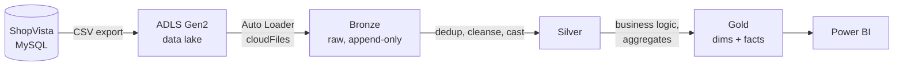

# E-Commerce Analytics Pipeline (ShopVista): Spark & Azure Databricks

End-to-end e-commerce analytics pipeline on **Azure Databricks** using a **Bronze / Silver / Gold medallion architecture**, **Delta Lake** and **Unity Catalog**. Raw order, customer and product data lands in ADLS Gen2, is ingested incrementally with Auto Loader, and ends up as analytics-ready Gold tables that feed Power BI dashboards.

**Tech stack:** Azure Databricks · PySpark · Delta Lake · Unity Catalog · ADLS Gen2 · Auto Loader · Databricks Workflows · Power BI

## Architecture



Everything is governed through Unity Catalog (catalog `ecommerce` with `bronze`, `silver` and `gold` schemas) on an ADLS Gen2 external location secured by an Access Connector.

## Key features

- **Incremental ingestion:** Auto Loader with schema evolution (rescue mode) and per-table checkpoints. Bronze is append-only and runs with `trigger(availableNow=True)`.
- **Dimension and fact pipelines:** separate Bronze → Silver → Gold notebooks for dimensions and facts.
- **Incremental daily summary:** `gld_fact_daily_orders_summary` is built with a full historical load on the first run, then a rolling 30-day recalculation merged via Delta Lake `MERGE`, keyed on `date_id` and `currency`. History is never reprocessed in full.
- **Multi-currency:** aggregations are computed per currency across 7 currencies.
- **Monthly Returns & Shipments ETL:** an extension module on the same pattern.
  - Returns: dedup, type casting and standardized reasons, plus `return_days` and `within_policy` / `is_late_return` flags (15-day policy).
  - Shipments: carrier standardization, a Domestic / International `carrier_group`, and an `is_weekend_shipment` flag.
  - Orchestrated as a scheduled Databricks Job (`monthly_job`): bronze → silver → gold, run monthly at 02:00 on the 1st.

## Gold layer tables

`gld_dim_customers` · `gld_dim_date` · `gld_dim_products` · `gld_fact_order_items` · `gld_fact_daily_orders_summary` · `gld_fact_order_returns` · `gld_fact_order_shipments`

## Repository structure

```
.
├── 1_medallion_processing_dim/    # dimension tables: bronze → silver → gold notebooks
└── 2_medallion_processing_fact/   # fact tables: bronze → silver → gold, daily summary
```

## Dashboard

The Power BI report on the Gold layer covers total sales, units sold, repeat-customer rate, customer count and sales by region, sales by channel (Mobile / Website), and the monthly revenue trend.

<!-- Add a dashboard screenshot here:  -->

## How to run

1. Create an ADLS Gen2 account and a Unity Catalog external location (via an Access Connector).
2. Create the `ecommerce` catalog with `bronze`, `silver` and `gold` schemas.
3. Upload the source CSVs to the ADLS container and set the storage account and container names in the notebooks.
4. Run the dimension notebooks, then the fact notebooks, in layer order.
5. Schedule the monthly returns and shipments job as a Databricks Workflow.

## Author

**Jaswanth Kumar Dowpati**: [LinkedIn](https://www.linkedin.com/in/jaswanth-dowpati-694336340) · [GitHub](https://github.com/jaswanthdowpati35-maker)
